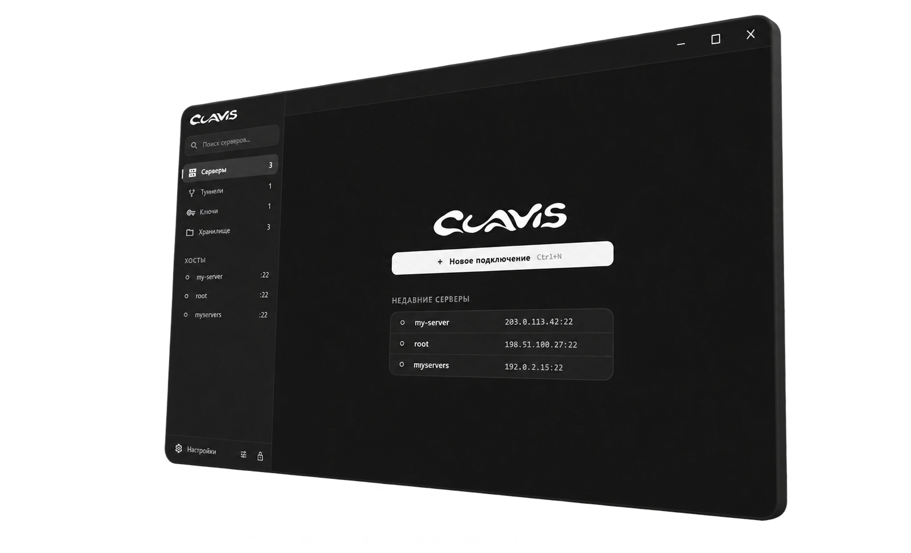

  Русский · <a href="github/README.en.md">English</a>

   
  <picture>
    <source media="(prefers-color-scheme: dark)" srcset="github/assets/logo_full.svg" />
    <source media="(prefers-color-scheme: light)" srcset="github/assets/logo_full_dark.svg" />
    
  </picture>

    

  

    <strong>Ваши серверы. Ваши ключи. Ваш контроль.</strong> 
    Локальный SSH-клиент для Windows: терминал, SFTP, ключи и туннели в одном окне.
  

  

    <a href="https://github.com/vaxxron/Clavis/releases/latest"><strong>Скачать v1.1.0 Beta</strong></a>
    &nbsp;·&nbsp;
    <a href="#возможности">Возможности</a>
    &nbsp;·&nbsp;
    <a href="#безопасность">Безопасность</a>
    &nbsp;·&nbsp;
    <a href="#установка">Установка</a>
    &nbsp;·&nbsp;
    <a href="https://github.com/vaxxron/Clavis/issues">Issues</a>
  

   

  

 

**Clavis** — лёгкий клиент для работы с серверами по SSH с философией **local-first**. Хосты, пароли и ключи шифруются и хранятся только на вашем ПК — без облака, аккаунтов и телеметрии.

 

## Возможности

<table>
  <tr>
    <td width="50%" valign="top">
      <strong>Быстрый терминал (60 FPS)</strong> 
      Вкладки, 256 цветов и буферизация вывода без фризов на больших логах.
    </td>
    <td width="50%" valign="top">
      <strong>SFTP-проводник</strong> 
      Фоновая передача файлов без блокировки терминала, предпросмотр и мгновенная отмена.
    </td>
  </tr>
  <tr>
    <td width="50%" valign="top">
      <strong>Туннели и OpenSSH</strong> 
      Проброс портов в один клик и автоимпорт хостов и ключей из <code>~/.ssh/</code>.
    </td>
    <td width="50%" valign="top">
      <strong>Интеграция с aaPanel</strong> 
      Открытие веб-панели через локальный SSH-туннель без открытия порта наружу.
    </td>
  </tr>
</table>

 

## Безопасность

* **Локальный Vault:** `Argon2id` + `AES-256-GCM` с проверкой целостности (AAD).
* **Защита от MITM:** проверка отпечатков серверов (`known_hosts`) при подключении.
* **Полная автономность:** работает офлайн, без трекеров и скрытой аналитики.

 

## Установка

Для **Windows 10 / 11 (x64)**:

1. Откройте [GitHub Releases](https://github.com/vaxxron/Clavis/releases/latest) и скачайте `ClavisSetup_Beta_v1.1.0.exe`.
2. Запустите установщик — дополнительные зависимости не требуются.

Нашли ошибку или есть идея? Создайте [Issue](https://github.com/vaxxron/Clavis/issues).

---

  Windows 10 / 11 (x64) · v1.1.0 Beta · <a href="https://github.com/vaxxron/Clavis">vaxxron/Clavis</a>

