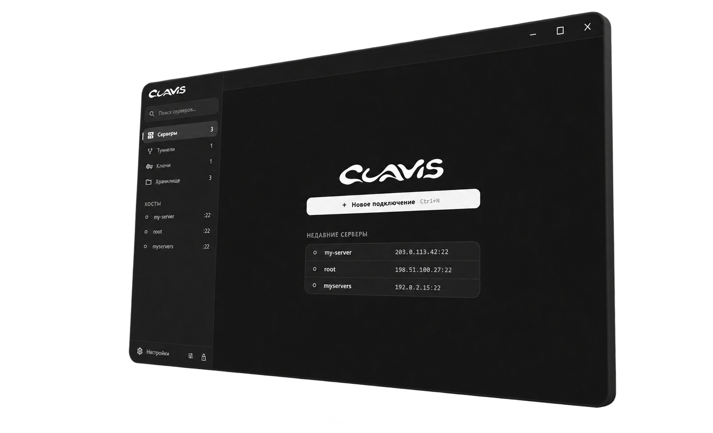

  <a href="../README.md">Русский</a> · English

   
  <picture>
    <source media="(prefers-color-scheme: dark)" srcset="assets/logo_full.svg" />
    <source media="(prefers-color-scheme: light)" srcset="assets/logo_full_dark.svg" />
    
  </picture>

    

  

    <strong>Your servers. Your keys. Your control.</strong> 
    A local-first SSH client for Windows: terminal, SFTP, keys, and tunnels in one window.
  

  

    <a href="https://github.com/vaxxron/Clavis/releases/latest"><strong>Download v1.1.0 Beta</strong></a>
    &nbsp;·&nbsp;
    <a href="#features">Features</a>
    &nbsp;·&nbsp;
    <a href="#security">Security</a>
    &nbsp;·&nbsp;
    <a href="#installation">Install</a>
    &nbsp;·&nbsp;
    <a href="https://github.com/vaxxron/Clavis/issues">Issues</a>
  

   

  

 

**Clavis** is a lightweight **local-first** SSH client. Your hosts, passwords, and keys stay encrypted on your own machine — no cloud sync, accounts, or telemetry.

 

## Features

<table>
  <tr>
    <td width="50%" valign="top">
      <strong>60 FPS Terminal</strong> 
      Tabs, 256 colors, and throttled buffering so heavy logs never freeze the UI.
    </td>
    <td width="50%" valign="top">
      <strong>SFTP File Manager</strong> 
      Background transfers without blocking the shell, previews, and instant cancellation.
    </td>
  </tr>
  <tr>
    <td width="50%" valign="top">
      <strong>Tunnels &amp; OpenSSH</strong> 
      One-click port forwarding and auto-discovery of hosts and keys from <code>~/.ssh/</code>.
    </td>
    <td width="50%" valign="top">
      <strong>aaPanel Integration</strong> 
      Access your web panel over an automatic local SSH tunnel without exposing ports.
    </td>
  </tr>
</table>

 

## Security

* **Local Vault:** `Argon2id` + `AES-256-GCM` with AAD integrity verification.
* **MITM Protection:** `known_hosts` fingerprint verification on connect.
* **Offline-first:** zero trackers, analytics, or external cloud dependencies.

 

## Installation

For **Windows 10 / 11 (x64)**:

1. Open [GitHub Releases](https://github.com/vaxxron/Clavis/releases/latest) and download `ClavisSetup_Beta_v1.1.0.exe`.
2. Run the installer — no extra dependencies required.

Found a bug or have an idea? Open an [Issue](https://github.com/vaxxron/Clavis/issues).

---

  Windows 10 / 11 (x64) · v1.1.0 Beta · <a href="https://github.com/vaxxron/Clavis">vaxxron/Clavis</a>

